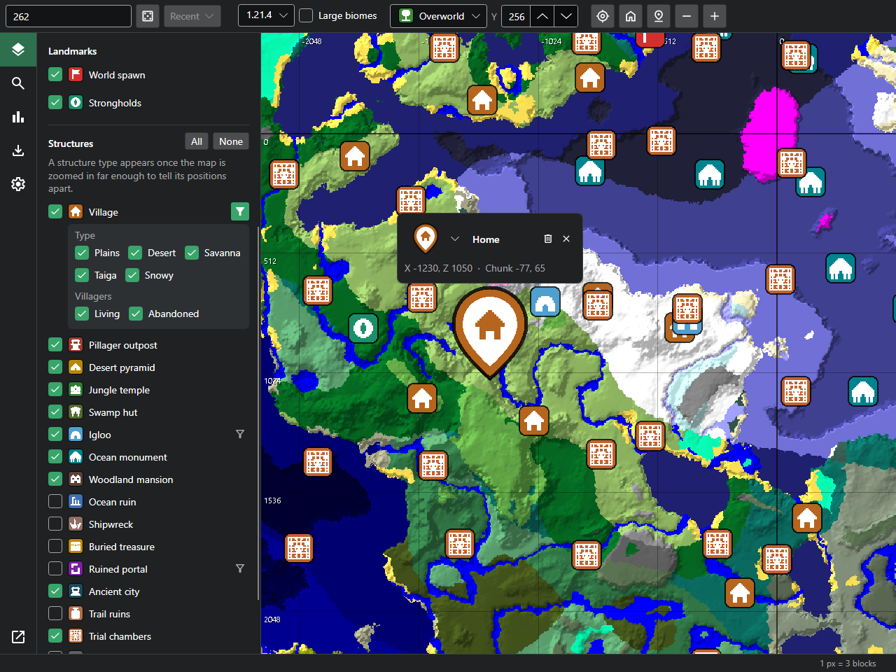

# Cubiomes Viewer

A cross-platform Minecraft Java Edition seed finder and biome map viewer, built on top of the [cubiomes](https://github.com/Cubitect/cubiomes) world-generation library, in [xpple's maintained fork](https://github.com/xpple/cubiomes).



[Open the web version](https://der-floh.github.io/Cubiomes-Viewer) · [Download for Windows, Linux, macOS or Android](#download)

## Features

- **Biome map** of any seed from Beta 1.7 to 26.3, in the Overworld, Nether and End, with structures, strongholds, the spawn point and slime chunks marked.
- **Structure details** on a click: the variant, the Y level, the rooms of larger structures and, if you turn it on, what the chests hold.
- **More layers**: climate parameters, surface heights, rivers, ocean temperatures and where a structure type can generate, plus optional relief shading of the biome map.
- **Seed search** for seeds that meet a list of conditions, in the app or from the command line.
- **Analysis** of the biomes, structures and locations around a point, for one seed or up to 1,000 found seeds.
- **Export** of any layer as PNG images of any size, whole or cut into tiles.
- **Map tools**: pins, distance measurements, links to a spot, find nearest structure or biome, and the matching portal spot in the other dimension.
- **Desktop, Android and web**: Windows, Linux, macOS, Android phones and the browser; the desktop and Android apps tell you when a newer version is out.

### Map

- Zoom from single blocks out to whole regions, and drag with the left or right mouse button; on a touch screen, drag with one finger and pinch to zoom.
- The world bar sets the seed (or a random one), version, large biomes, dimension and the Y level biomes are read at; Shift + mouse wheel steps the Y level.
- The status bar shows the biome or value, block and chunk under the pointer, the map scale and the app version. While an image export, an analysis or a seed search through a limited range of seeds runs, it fills from the left to show how far it has come.
- Layers: biomes, structure potential, climate parameters (temperature, humidity, continentalness, erosion, depth, weirdness), rivers, ocean temperatures and surface height, as far as the version has them.
- Surface heights can be tinted, shaded, drawn as contour lines or in grey. Settings → Map can also shade the biome map by terrain height.
- Markers for the structure types you choose, down to their variants (such as nether fossils with a dried ghast, from 1.21.6), plus the world spawn, strongholds, slime chunks and End gateways.
- Clicking a structure shows its variant and its Y level, and draws the rooms of end cities, fortresses, strongholds and mineshafts on the map; a stronghold also tells where its portal room is and, from 1.13, how many eyes of ender its end portal already holds.
- With Settings → Map → Show what chests hold, the callout also lists the chests of desert pyramids, jungle temples, igloos, pillager outposts, shipwrecks, buried treasure, ruined portals, mineshafts, fortresses, bastions, end cities, strongholds and abandoned camps, each with what the game fills it with when it is first opened, from 1.13 on (outposts from 1.14, ruined portals from 1.16, bastions from 1.16.5, Nether ruined portals from 1.18, camps from 26.3). Chests have no Y; ruined portal and camp chests stand at estimated places, mineshafts may list a few minecarts the game leaves out, and bastions only the chests every bastion of their kind has.
- The Y level is exact where the game fixes it or the terrain decides it: ancient cities, monuments, bastions, trial chambers, nether fossils, end cities, villages, woodland mansions and, from 1.20, jungle temples and swamp huts. Desert pyramids from 1.18 and some fortresses show the few levels the game picks from by chance, and other structures on the ground an estimate (≈). Exact terrain needs 1.14 or later; strongholds, mineshafts and ruined portals have no Y.
- Biomes in the default colours or in colour maps of your own, edited live on the map and shared as JSON files.
- On the desktop, the map can move into a window of its own, for a second screen.

### Right-click menu

Opens with a right-click on the map, or on a touch screen by touching and holding the map.

- Copy the block's coordinates, `/tp` command, chunk, region file or the seed.
- Put a pin on the block, or measure the distance to another one. Pins and measurements are kept per seed and dimension and can be named.
- **Copy link to this spot**: opens the web version on the same world and view, with up to 100 pins of that map, for example `https://der-floh.github.io/Cubiomes-Viewer/?seed=262&version=1.21.3&dimension=nether&x=100&z=-50&scale=4&pin=120,-40,Base`. A link pasted into the seed box opens the same way, on the desktop too. Opening a link adds its pins to yours, except on blocks that have a pin already.
- **Find nearest structure or biome**: like the game's `/locate`, as far out as the game looks. The map then flies to the result.
- **Open in the Nether or Overworld**: the matching spot in the other dimension, for planning portals.

### Seed search

- **Conditions**, each required or excluded, and each able to look around where another one was found:
  - structures, optionally of one kind (end cities with an end ship, abandoned villages, igloos with a basement, giant ruined portals, nether fossils with a dried ghast) or with an item in their chests, and four huts close enough for one farm
  - biomes: one of them, each of them, a share of the area, or a patch of a size
  - climate parameters of the 1.18+ Overworld, and the temperature categories of 1.7 to 1.17
  - the world spawn, strongholds (optionally with eyes already in their end portal, from 1.13, or with an item in their chests), slime chunks, and "any of" several conditions
- **Chest loot** (while Settings → Map shows what chests hold): an item the chests of the structures or strongholds hold, at least a number of it in one chest or in all chests together, optionally with an enchantment of a lowest level, such as an enchanted book with Mending.
- **An area or a number of findings**: a structure or stronghold condition looks inside its area, or outward from its point, nearest first, until it has found as many as it asks for, as far as the world border, such as the nearest stronghold with an enchanted book in its chests.
- **Seeds** from a range, a list, structure seeds (each with its 65,536 sister seeds) or the quad-hut bases.
- **Fast**: a quick pass rules seeds out without generating biomes, about 68 million structure seeds a second on 15 desktop threads.
- **Kept**: a stopped or interrupted search continues after a restart, and can be saved to and opened from a file.
- **Examples** show what a search can look for, and any setup can be kept as a preset.

### Command line

`cubiomes-viewer-cli` runs a search saved with Save to file in the Search panel without the app, for example on a server:

```bash
cubiomes-viewer-cli --session search.json --out seeds.txt
```

- Seeds are printed as they are found, or written to the file given with `--out`; progress shows in the terminal.
- Progress is saved back into the session file, so Ctrl+C stops the search, the same command continues it, and the app opens it where the CLI left off. `--reset` starts over.
- Use a CLI at least as new as the app that saved the search. An older one leaves out what it does not know, such as a chest requirement or a limit by findings, or cannot open the file.
- `--selftest` runs the app's self-test.
- Exit codes: 0 finished, 1 failed, 2 invalid arguments, 130 stopped.

### Analysis

- For the seed on the map, or up to 1,000 found seeds, around a point:
  - **Biomes**: how many samples each biome has in a square or circle around it, and its sample nearest to the centre
  - **Structures**: those in a square or circle around it, nearest first with their details, and quads of swamp huts, desert pyramids, jungle temples or igloos
  - **Locations**: the spawn point, as many strongholds as you ask for, nearest first, and where the search conditions hold, each in its own area or by its own number of findings
- Every list can be saved as a CSV file, and choosing a line opens its seed at that place on the map.

### Export

- Saves the layer the map shows as one PNG per seed, at any scale and size; several seeds, or an image cut into tiles, become a ZIP archive.
- Biome PNGs keep the biome id as palette index, so tools can read the biomes back. A layer with no more than 15 biomes, such as the Nether, the End, rivers or ocean temperatures, stores a palette of just those instead, packed into 1 to 4 bits per pixel, so there the index is not the biome id.
- Layers of numbers, such as temperature or tinted heights, are drawn on the map and saved in 256 colour steps, too fine to tell apart, so they are palette images too; contour lines take 128 steps and a darker copy of each. Heights in grey are greyscale images, and shaded heights and biomes shaded by terrain height keep every colour.
- Images are written row by row, so even huge ones need little memory; the panel warns about images many programs cannot open.
- Strong compression: libdeflate at its strongest level, with the PNG filter that suits the layer and scale tried anew on every band of rows. A 32,000 × 32,000 temperature map at 1:16 comes to 134 MB, the biomes at 1:4 to 54 MB.

### Settings

- **Appearance**: theme and interface size.
- **Map**: smooth motion, relief shading of the biome map, what chests hold (off at first), tile cache, grid spacing, marker size, and how far out each structure type is marked.
- **World generation**: the experimental versions (Beta 1.7, Beta 1.8 and 1.0), the terrain estimate that leaves out some structures on low land from 1.18 on, and replaced structure salts, as servers and data packs use them.
- **Start**: open the last world and search, and keep the desktop window's size and position.
- **Export**: the separator of CSV files.
- **Updates** (desktop and Android): the installed version, a check on request, and whether the app tells you about new versions at start.
- **Diagnostics**: Run self-test checks the generator against reference values and measures tile throughput, about 180–200 tiles/s on 16 desktop threads and 75–105 on 6 Web Workers.

## Download

| | Installer | Portable |
| --- | --- | --- |
| **Windows** x64 | [Setup.exe](https://github.com/Der-Floh/Cubiomes-Viewer/releases/latest/download/CubiomesViewer-win-x64-Setup.exe) | [zip](https://github.com/Der-Floh/Cubiomes-Viewer/releases/latest/download/CubiomesViewer-win-x64-Portable.zip) |
| **Windows** ARM64 | [Setup.exe](https://github.com/Der-Floh/Cubiomes-Viewer/releases/latest/download/CubiomesViewer-win-arm64-Setup.exe) | [zip](https://github.com/Der-Floh/Cubiomes-Viewer/releases/latest/download/CubiomesViewer-win-arm64-Portable.zip) |
| **macOS** Apple Silicon | [Setup.pkg](https://github.com/Der-Floh/Cubiomes-Viewer/releases/latest/download/CubiomesViewer-osx-arm64-Setup.pkg) | [zip](https://github.com/Der-Floh/Cubiomes-Viewer/releases/latest/download/CubiomesViewer-osx-arm64-Portable.zip) |
| **macOS** Intel | [Setup.pkg](https://github.com/Der-Floh/Cubiomes-Viewer/releases/latest/download/CubiomesViewer-osx-x64-Setup.pkg) | [zip](https://github.com/Der-Floh/Cubiomes-Viewer/releases/latest/download/CubiomesViewer-osx-x64-Portable.zip) |
| **Linux** x64 | [AppImage](https://github.com/Der-Floh/Cubiomes-Viewer/releases/latest/download/CubiomesViewer-linux-x64.AppImage) | |
| **Android** 64-bit, 7.0 and later | [APK](https://github.com/Der-Floh/Cubiomes-Viewer/releases/latest/download/CubiomesViewer-android.apk) | |

<!-- On Windows, the setup is also on winget: `winget install Der_Floh.CubiomesViewer`. -->

Nothing to install: [open the web version](https://der-floh.github.io/Cubiomes-Viewer).

- Updates: at start the desktop and Android apps look for a newer release on GitHub. When there is one, a notice opens its page, goes away, or stops showing up until Settings → Updates turns it on again. To update, download and install the new version from the table above; your settings and searches stay.
- macOS: the app is not signed, so macOS blocks the first start until it is allowed in System Settings → Privacy & Security → Open Anyway.
- Linux: make the AppImage executable before the first start (`chmod +x CubiomesViewer-linux-x64.AppImage`).
- Android: open the downloaded APK and, when Android asks, allow the browser or file manager to install apps. A newer APK installs over the old one.

**Command line** (seed searches without the app): [Windows x64](https://github.com/Der-Floh/Cubiomes-Viewer/releases/latest/download/cubiomes-viewer-cli-win-x64.zip) · [Windows ARM64](https://github.com/Der-Floh/Cubiomes-Viewer/releases/latest/download/cubiomes-viewer-cli-win-arm64.zip) · [Linux x64](https://github.com/Der-Floh/Cubiomes-Viewer/releases/latest/download/cubiomes-viewer-cli-linux-x64.tar.gz) · [macOS Apple Silicon](https://github.com/Der-Floh/Cubiomes-Viewer/releases/latest/download/cubiomes-viewer-cli-osx-arm64.tar.gz) · [macOS Intel](https://github.com/Der-Floh/Cubiomes-Viewer/releases/latest/download/cubiomes-viewer-cli-osx-x64.tar.gz)

## Building

Requirements:

- .NET 10 SDK, with the `wasm-tools` workload for the Browser head and the `android` workload for the Android head.
- clang for the native `cvnative` library. On Windows it also needs the Visual Studio C++ build tools, whose installer can add clang as "C++ Clang Compiler for Windows"; cubiomes does not build with MSVC itself.
- For the Android head, the Android SDK and NDK (r27 or later), found through `ANDROID_HOME` and `ANDROID_NDK_HOME` or in their usual places.

Clone with submodules, then build and test:

```bash
git clone --recurse-submodules https://github.com/Der-Floh/Cubiomes-Viewer
```

```bash
dotnet test Cubiomes_Viewer.Engine.Tests
```

The native library is built automatically when a head or test project is built and its output is missing or older than the sources. It can also be built directly with `native/build.ps1 -Rid win-x64`, or `-Rid android-arm64` and `-Rid android-x64` for Android.

Run the Desktop or Browser head, or the command line from source:

```bash
dotnet run --project Cubiomes_Viewer.Desktop
```

```bash
dotnet run --project Cubiomes_Viewer.Browser
```

```bash
dotnet run --project Cubiomes_Viewer.Cli -- --session search.json --out seeds.txt
```

The Android head runs on a connected phone or a running emulator:

```bash
dotnet build Cubiomes_Viewer.Android -t:Run
```

### Browser workers and storage

- Heavy work runs in a pool of Web Workers (one per logical processor minus one, at most six), each hosting a small .NET runtime (`Cubiomes_Viewer.Browser.Worker`) with the engine and the natively linked generator. Jobs and results cross as serialized messages.
- A worker that fails is replaced and its job given to another worker once; when no worker can start, the jobs run on the main thread instead.
- Settings and the search session are kept in IndexedDB.
- In development the Browser head serves the worker project under `/worker/`. On publish the worker is published separately into `wwwroot/worker/`, because the WebAssembly SDK would otherwise merge its assemblies into the main app's boot manifest. Always publish with `dotnet publish Cubiomes_Viewer.Browser -c Release`.

### Tests

- The engine tests compare map tiles, search and find-nearest results, analysis counts and exported pixels with the generator, and pin sixteen exports of fixed worlds by their hashes.
- The CLI tests run example searches through the CLI and through the app's search and compare the seeds, also across a stop and a second run.
- The self-test checks the generator, structures, strongholds, End gateways, the spawn point, slime chunks and the other layers against values recorded from the Windows build, which is how other platforms prove they generate identical worlds.

## License

[MIT](LICENSE.txt). Third-party licenses are listed in [THIRD-PARTY-NOTICES.md](THIRD-PARTY-NOTICES.md).
